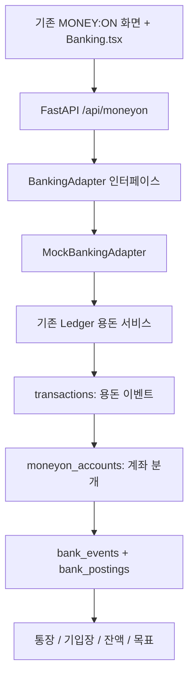

# MONEY:ON Phase 2 — 은행 앱 연계형 프로토타입

## 결과와 범위

부모 가상 통장에서 아이 통장으로 용돈과 보상 이자를 이체하고, 가상 소비가 통장·용돈기입장·예상 이자·리포트에 동시에 반영되는 로컬 프로토타입을 구현했다. 금고 이동도 같은 원장에 연결했다. 실제 은행·결제·외부 LLM API는 호출하지 않는다. 운영 DB 변경, 배포, Git push는 수행하지 않았다.

## 기존 코드 확인과 재사용

직접 확인한 기존 구현은 Next.js/React 화면 `/moneyon`, FastAPI `/api/moneyon`, SQLite `Ledger` 서비스다. 부모·아이 UI 상태와 MONEY:ON 세션은 React 메모리에 있고, 금융 데이터는 SQLite에 영속 저장되어 있었다. localStorage는 기존 AI LAB 인증에만 사용하며 금융 잔액을 저장하지 않는다.

기존 `Ledger.transact`의 지급 주기·정책 스냅샷·금액 검증·적격 잔액·금고 제외·중복 키·부모 승인 계산을 재사용했다. 새 이자 엔진이나 독립된 지출 장부를 만들지 않았다. 기존 수동 기록, 지출 취소, 퀘스트·테마·목표도 유지한다.

## 계층과 원장



인터페이스는 `get_accounts`, `get_account_balance`, `get_transactions`, `transfer_allowance`, `simulate_purchase`, `transfer_to_savings`, `transfer_from_savings`, `settle_reward_interest`를 정의한다. 구현체는 `MockBankingAdapter` 하나이며 네트워크 클라이언트가 없다. 기존 API도 이 어댑터를 사용한다. 수동 지출과 취소는 기존 서비스 경로를 유지하지만 `_entry`가 동일 계좌 분개를 작성한다.

실제 은행 어댑터로 전환하려면 원격 승인·재시도·상태 조정과 별도 인증이 필요하다. 현재 SQLite 원자성을 원격 은행까지 보장하는 것으로 해석하면 안 된다.

## 데이터 모델과 보존

스키마 버전 2를 추가한다. 기존 테이블과 거래 ID·금액·정책을 변경하거나 삭제하지 않는다.

| 추가 테이블 | 역할 |
|---|---|
| `bank_accounts` | 가족·아이 소유권, parent/wallet/vault/clearing 종류, 별명, 고유 DEMO ID |
| `bank_events` | 이체 ID, 원래 거래 ID(고유), 거래 유형·가맹점·일시·상태·이관 여부 |
| `bank_postings` | 계좌별 부호 있는 정수 금액, 거래 후 잔액, 동일 이벤트 연결 |
| `bank_category_changes` | 원본을 보존하는 카테고리 변경 이력 |
| `moneyon_demo_workspaces` | 데모 소유 가족, 독립 가족 ID, 기준 날짜, 활성 여부 |

계좌 ID는 `DEMO-P-…`(부모), `DEMO-C-…`(아이 통장), `DEMO-S-…`(금고)다. 외부 금융기관 계좌번호가 아니다. 화면에 **가상 계좌 · 실제 금융 거래 아님**을 표시한다. 내부 조정 계좌 `DEMO-X-…`는 화면에 노출하지 않는다.

잔액은 분개 합계다. 별도의 수정 가능한 balance 컬럼을 만들지 않았다. `balance_after`는 계좌 내역의 역사적 표시값이며 현재 잔액 계산에 사용하지 않는다. 거래일시·가맹점·금액·카테고리·유형·상태·거래 ID·이체 ID·거래 후 잔액을 통장에 제공한다. 입출금 관점과 소비 카테고리 관점은 같은 이벤트를 조회한다.

기존 Phase 1 데이터가 있는 DB를 처음 열면 거래를 원래 순서와 금액으로 한 번 분개한다. 기존 지급·지출·이자·금고 데이터는 이관 표시를 붙이며 내부 조정 계좌를 상대 계정으로 사용한다. 새 부모 통장의 시작 금액은 500,000원이고 과거 지급액을 소급 차감하지 않는다. 초기 잔액을 추가로 아이 통장에 다시 넣지 않는다. 버전과 원래 거래 ID의 고유 제약으로 재실행 시 중복 반영을 막는다.

## 거래 규칙

- 용돈: 기존 정책 금액만큼 부모 출금과 아이 입금을 하나의 DB 트랜잭션에서 기록한다. 주기당 한 번, 동일 요청 키 재전송은 한 번만 처리한다.
- 가상 소비: 편의점 2,000원→간식, 문구점 4,000원→문구, 서점 5,000원→책, 게임 3,000원→게임. 기존 `expense` 이벤트와 같은 소비·이자 계산을 사용한다. 실제 결제는 발생하지 않는다.
- 수동 지출도 같은 통장에 `MANUAL_EXPENSE`로 보인다. 가상 소비는 `SIMULATED_PURCHASE`다. 가상 소비를 다시 수동 지출로 자동 복제하지 않는다.
- 카테고리: 아이 본인 또는 부모가 수정할 수 있다. 원본 거래의 금액·ID는 유지하며 별도 이력을 남긴다. 통장·기입장·부모 리포트에 같은 분류가 반영된다. 취소 역거래도 원래 거래의 현재 분류를 따른다.
- 보상: 기존 `reward` 함수와 주기 스냅샷으로 계산한다. 종료 후 부모 승인 시 부모 출금/아이 입금을 `PARENT_REWARD_INTEREST`로 묶는다. 실제 은행 예금 이자와 구분한다. 부모 잔액이 부족하면 승인하지 않는다.
- 금고: 아이 통장 출금/금고 입금을 같은 이체 ID로 묶는다. 반대 방향도 지원하며 소비액으로 집계하지 않는다. 보유 총액은 보존되고 기존 목표 달성률에 반영된다.
- 취소: 원본과 반대 거래를 모두 남긴다. 기존 Phase 1의 종료·정산 주기 취소 제한도 유지한다.
- 모든 계좌 이벤트의 분개 합계는 0이다. 데모 시작금과 과거 이관, 소비는 내부 조정 계좌를 사용한다.
- `BEGIN IMMEDIATE`, 계좌 분개 외래 키, 이벤트별 계좌 고유 제약, 기존 요청 키 고유 제약을 함께 사용한다. 중간 분개 실패·부모 잔액 부족·아이 잔액 부족은 이벤트·분개·주기·정산 상태 모두 롤백한다. 같은 키로 다른 금액/종류의 거래를 요청하면 거절한다.

수치 검증 예시: 부모 500,000원 → 재현에게 10,000원 이체 → 부모 490,000원, 아이 10,000원 → 문구점 4,000원 소비 → 아이 6,000원, 예상 보상 600원 → 주기 종료·승인 → 부모 489,400원, 아이 6,600원 → 금고에 1,000원 → 아이 통장 5,600원, 금고 1,000원. 서연의 계좌는 변하지 않는다.

## API

기존 지급·지출·이자·저축 API 경로를 유지했다.

| 메서드·경로(`/api/moneyon` 기준) | 기능 |
|---|---|
| `GET /banking` | 부모 계좌·가족 계좌 목록·계좌별 전체 거래, 데모 상태 |
| `GET /children/{child}` | 기존 상태와 `banking.accounts`, `banking.transactions` |
| `POST /children/{child}/transactions` | 기존 kind와 key 재사용. 가상 소비는 `kind=expense`, `merchant`, `amount` |
| `PATCH /children/{child}/transactions/{id}/category` | 금액 변경 없는 소비 분류 정정 |
| `POST /demo/start` | 별도 시연 가족과 부모 세션 생성 |
| `POST /demo/date` | 현재 데모의 기준 날짜를 미래로 이동 |
| `POST /demo/reset` | 현재 데모를 보관하고 새 가족 생성 |

기존 AI LAB 토큰 + `X-Moneyon-Session` 검증을 유지한다. 데모는 `X-Moneyon-Demo`를 추가하며 서버가 현재 AI LAB 사용자와 해당 데모의 소유 관계를 확인한다. 아이 세션은 부모 계좌·다른 아이·데모 설정을 조회/변경할 수 없다. 주기 날짜는 `business_date(ctx)`로 가족별 결정하며 전역 날짜를 변경하지 않는다.

## DEMO 시연과 초기화

1. 기존 AI LAB 로그인 및 부모 PIN 인증.
2. 부모 통장의 **시연 가족 시작** 선택. 기존 자녀는 그대로 두고 별도 가족을 만든다.
3. 재현(3학년, 주간 10,000원, 10%)·서연(5학년, 월간 30,000원, 5%)이 표시된다. 두 아이의 시작 잔액은 0원이다. 지급일은 시연 시작일의 요일/날짜로 정한다.
4. 재현을 선택해 용돈 지급 → 아이로 시작 → 내 통장에서 입금 확인 → 홈의 문구점 가상 소비 → 용돈기입장에서 자동 분류 확인·수정.
5. 잠그기 후 같은 부모 PIN으로 데모에 다시 진입. 부모 화면의 **데모 날짜**를 해당 주기 종료일로 이동한다.
6. 재현의 보상 이자 승인 → 아이로 시작 → 통장의 보상 입금 확인 → 금고·저축 목표 확인.
7. **데모 새로 시작 → 새 시연 가족 만들기**는 이전 데모의 거래를 삭제하지 않고 새 DEMO ID와 부모 500,000원 계좌를 만든다. 이전 공간은 비활성으로 보관하고 세션을 폐기한다.
8. **기존 가족으로 돌아가기** 후 원래 부모 PIN으로 다시 인증하면 기존 자녀·계좌가 그대로 보인다.

날짜는 데모에서만 현재 날짜 이후 366일 이내로 이동할 수 있고 뒤로 되돌릴 수 없다. 날짜를 되돌리는 시연은 새 데모를 만든다. 실제 시스템 시계와 기본 가족의 주기 계산은 변경하지 않는다. 실제 운영 환경에서는 데모 엔드포인트를 차단한다.

## 실행 방법

기존 프로젝트의 API 의존성이 설치된 Python 환경에서, 프로젝트 루트 PowerShell:

```powershell
$env:MONEYON_LOCAL_DEV='1'
$env:MONEYON_DEMO='1'
$env:APP_ENV='development'
.venv/Scripts/python.exe -m uvicorn api.main:app --host 127.0.0.1 --port 8000
```

이 머신에서는 `.venv`와 기존 `venv`에 의존성이 나뉘어 있다. 기존 에이전트를 포함한 실행에 필요한 패키지가 `.venv`에 없으면, 이미 설치된 `venv` 패키지를 보조 경로로 추가할 수 있다(신규 설치나 운영 설정 변경 없음).

```powershell
.venv/Scripts/python.exe -c "import sys,uvicorn; sys.path.append('venv/Lib/site-packages'); uvicorn.run('api.main:app', host='127.0.0.1', port=8000)"
```

별도 터미널에서 `cd web; npm run dev` 후 `http://localhost:3000/moneyon` 접속. 기존 AI LAB 접속 코드가 필요하며, 데모도 기존 인증을 우회하지 않는다. 브라우저 테스트만 격리된 가짜 AI LAB 신원을 주입한다.

`MONEYON_DB` 기본값은 `data/moneyon/development.sqlite3`다. 실제 은행 접속 키는 필요 없다. `MONEYON_LOCAL_DEV=1`이 없거나 `APP_ENV=production/prod`면 MONEY:ON API는 계속 차단한다. `MONEYON_DEMO=1`이 없으면 가상 날짜·초기화·시연 가족 API를 차단한다.

## 검증과 증거

실행 명령:

```powershell
.venv/Scripts/python.exe -m unittest discover -s tests -p test_moneyon.py -v
.venv/Scripts/python.exe -m unittest discover -s tests -p test_moneyon_banking.py -v
cd web
npm run typecheck
$env:NEXT_BUILD_DIR='.next-moneyon'
npm run build
```

브라우저 테스트(루트):

```powershell
node tests/test_moneyon_browser.cjs
node tests/test_moneyon_banking_browser.cjs
node tests/test_analytics_frontend.cjs
```

기존 테스트 도구 `reports/analytics-browser/node_modules/playwright`와 설치된 Chrome을 사용한다. Phase 2 테스트는 loopback 3108/8108, Phase 1은 3107/8107의 별도 서버·DB를 사용하고 실행 후 서버를 종료한다. DB는 Git 제외된 `data/moneyon/phase2-browser-*`에 남기며 실제 개발 가족 DB를 사용하지 않는다. 브라우저 fixture는 `api.main`에 연결하지 않는다.

- 기존 MONEY:ON 32개 통과. API 테스트 클래스의 공통 원장 테스트 상속 실행을 포함한 수다.
- 신규 은행·DEMO 테스트 22개 통과: 부모/아이 계좌 생성, 복식 분개, 중복·동시 지급, 두 자녀의 동시 이체 시 공유 부모 잔액 보호, 부모 잔액 부족, 분개 중간 오류 롤백, 수동/가상 소비 통합, 카테고리 이력, 보상 이자 및 부족/중복 승인, 금고 총액 보존, 취소, 가족/아이 격리, 실제 신원과 데모 소유권, Phase 1 이관 재실행, 비파괴 데모 초기화, 가상 날짜 격리.
- 기존 UI·분석 API·사용현황 117개와 합계 **171개** 통과. 이전 보고의 148개는 공통 테스트와 MONEY:ON 일부를 포함한 합계이므로 148+32를 별개 테스트 수로 더하지 않았다.
- 기존 analytics 프런트엔드 전송·개인정보·중복 방지 테스트 통과.
- TypeScript 검사, 전체 Next 빌드와 `/moneyon` 생성 통과.
- Phase 1 브라우저 흐름 통과. Phase 2의 부모 로그인→시연 가족→용돈 이체→통장 입금→문구점 소비→기입장 자동 반영·분류 수정→예상 이자→가상 날짜→부모 승인→이자 입금→금고/목표→데모 새로 시작→원래 가족 복귀→AI LAB 메뉴까지 통과.
- 부모 이체·어린이 기입장·어린이 통장 각각 375/768/1440px에서 가로 넘침과 브라우저 런타임 오류 없음 확인.

결과: `reports/moneyon-phase2/browser-result.json`. 화면: `parent-transfer-375.png`, `parent-transfer-1440.png`, `child-book-375.png`, `child-account-375.png` 등. 초기 실패의 `failure.png`가 있더라도 최종 판정은 결과 JSON과 마지막 성공 실행을 기준으로 한다.

## 변경 파일

| 파일 | 변경 |
|---|---|
| `services/moneyon_accounts.py` | 신규 계좌·이벤트·분개·이관·조회 계층 |
| `services/moneyon_banking.py` | 신규 BankingAdapter 인터페이스와 Mock 구현 |
| `services/moneyon_demo.py` | 신규 비파괴 데모 공간·날짜 서비스 |
| `services/moneyon.py` | 기존 엔진 재사용, 같은 트랜잭션의 분개, 분개 기반 잔액, 분류 정정 조회 |
| `api/moneyon.py` | 기존 거래 API 어댑터 연결, 계좌·분류·DEMO API, 가족별 날짜 |
| `web/src/app/moneyon/Banking.tsx` | 부모/어린이 통장, 입출금/기입장, 가맹점 소비, 데모 도구 |
| `web/src/app/moneyon/banking.css` | 부모 은행 스타일·어린이 계좌·모바일·동작 감소 대응 |
| `web/src/app/moneyon/MoneyOn.tsx` | 기존 화면과 계좌 연결, 결과 메시지, 독립 데모 상태 |
| `tests/test_moneyon_banking.py` | 신규 은행·DEMO 단위/API 테스트 |
| `tests/test_moneyon_banking_browser.cjs` | 신규 전체 흐름·반응형 브라우저 테스트 |
| `tests/fixtures/moneyon_browser_api.py` | 테스트 전용 데모 소유권·기준일 지원 |
| `docs/MONEYON.md`, `docs/MONEYON_BANKING.md` | 기존 보고 업데이트와 상세 설계/결과 |

기존 미커밋 변경은 유지했고 브랜치·운영 설정·다른 에이전트 구현을 변경하지 않았다. 이번 작업에서 새 프레임워크나 런타임 라이브러리를 추가하지 않았다.

## 미검증·위험·다음 단계

- 실제 은행·오픈뱅킹·결제·계좌·인증서·운영 인증·운영 DB는 미연결 및 미검증이다. 이번 목표의 가상 시뮬레이션만 검증했다.
- 기존 모든 에이전트의 외부 API 실사용이나 실제 운영 데이터 회귀는 수행하지 않았다. 로컬 자동 테스트와 빌드 범위의 회귀다.
- 실제 모바일 기기 터치, 전체 스크린리더 접근성, 장시간·대량 거래 성능·다중 서버 부하는 미검증이다. 로컬 SQLite는 여러 서버 간의 원자성을 제공하지 않는다.
- 계좌 내역은 현재 전체 조회다. 운영 단계에는 페이지네이션, 인덱스·쿼리 예산, 백업·복구·감사 로그 보존 정책이 필요하다.
- 초기 500,000원은 가상 시연용 자금이다. 기존 거래 이관은 실제 외부 계좌의 정산·복구가 아니다. 서버 파일 손실 시 복구를 위해 영속 DB와 백업 설계가 필요하다.
- 기존 Phase 1의 부모 계정/동의/복구, 종료 주기 정정, 고급 금융 리포트·게임 확장 과제는 그대로 남아 있다.
- 실제 은행 탑재 검토의 다음 단계는 가족·권한 모델, 운영용 영속 원장, 거래 상태 조정 및 보안 정책을 먼저 정하고, 검토된 은행 sandbox 어댑터를 별도 승인 하에 연결하는 것이다.
